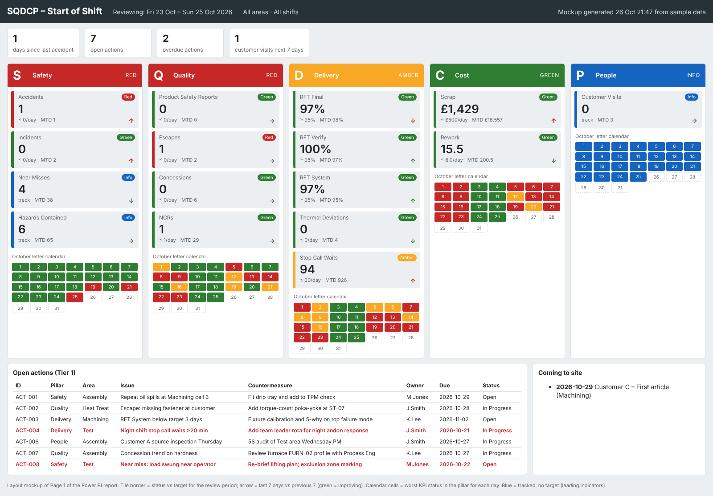

# SQDCP Start-of-Shift Dashboard (Power BI + Microsoft Teams)

This is a Tier 1 board for the morning start-of-shift meeting. It covers **Safety,
Quality, Delivery, Cost and People**. It is fed from the original source systems,
built in Power BI, and hosted in Microsoft Teams.

*Page 1 layout, generated from the sample data by `tools/build_mockup.py`. Open [`mockup/sqdcp-board.html`](mockup/sqdcp-board.html) in a browser for the live mockup.*

| Pillar | KPIs |
|---|---|
| **S**afety | Accidents · Incidents · Near Misses · Hazards Contained · *days since last accident* |
| **Q**uality | Product Safety Reports · Escapes · Concessions · NCRs |
| **D**elivery | RFT Final · RFT Verify · RFT System · Thermal Deviations · Stop Call Waits |
| **C**ost | Scrap (£) · Rework (hrs) |
| **P**eople | Customer Visits (on the day, and the next 7 days) |

## What the board does

* **Opens on the right day.** Tue–Fri it shows yesterday. Monday shows Friday plus
  the weekend. Night shift is credited to the day it started.
* **Red / amber / green against targets** held in one KPI master table, owned by
  Ops, not hard-coded. Each pillar letter shows the colour of its worst KPI.
* **Leading indicators are shown blue.** Near misses and hazards contained are
  tracked and celebrated, never given a "≤" target.
* **Month letter calendars** per pillar and per KPI, MTD values, and 7-day trend
  arrows coloured by whether the KPI is improving.
* **Every number links to its source record.** Drill-through lists the events, each
  with a link that opens the NCR, EHS report, serial-number history, andon call and
  so on in its own system.
* **The action log is on the board.** Open and overdue countermeasures from a
  Microsoft List sit next to the KPIs.

## Contents

| Path | What |
|---|---|
| [`docs/01-kpi-definitions.md`](docs/01-kpi-definitions.md) | KPI definitions, RAG rules, time rules, meeting standard |
| [`docs/02-data-sources.md`](docs/02-data-sources.md) | Architecture, source register, how to connect each live system, gateway and refresh |
| [`docs/03-power-bi-build-guide.md`](docs/03-power-bi-build-guide.md) | Step-by-step build: queries, model, measures, pages, drill-through |
| [`docs/04-teams-deployment.md`](docs/04-teams-deployment.md) | Teams hosting: channel tab, meeting tab, custom app, alerts, go-live checklist |
| `powerquery/*.m` | Every Power Query, ready to paste (parameters, source readers, shift logic, staging, facts, dimensions) |
| `dax/measures.dax` | All measures in one script for DAX query view, plus a test query |
| `theme/sqdcp-theme.json` | Report theme (RAG colours, shopfloor-readable fonts) |
| `sample-data/*.csv` | 60 days of realistic raw extracts per source system, plus the KPI master |
| `teams-app/` | Teams app manifest and icons. `tools/package_teams_app.py` builds the zip |
| `tools/generate_sample_data.py` | Regenerates sample data ending yesterday |
| `tools/build_mockup.py` | Rebuilds the mockup and prints expected KPI values, to check against Power BI |

## Quick start

1. Run `python3 tools/generate_sample_data.py`, then `python3 tools/build_mockup.py`
   to see the expected numbers.
2. Build the report on the sample data: [build guide](docs/03-power-bi-build-guide.md).
3. Publish it, create the Power BI app, and add it to Teams:
   [Teams deployment](docs/04-teams-deployment.md).
4. Swap each `stg_*` query from its CSV to the live system, one pillar at a time:
   [data sources](docs/02-data-sources.md).
